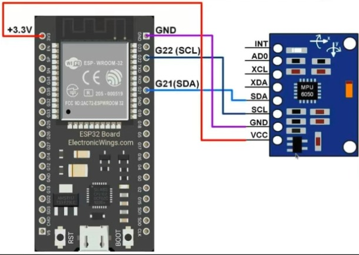

# Micro-ROS Gesture-Controlled Robot

This repository contains the ROS 2 packages for a gesture-controlled robot using micro-ROS. By utilizing an IMU sensor mounted on the user's hand, the system reads orientation and movement data, transmits it via micro-ROS, and translates these gestures into velocity commands to drive the robot.

## Hardware Connection: IMU & ESP32

Below is the connection diagram between the IMU sensor and the ESP32 microcontroller used for reading gestures:



## Repository Structure

As shown in the repository root, cloning this project will provide the ROS 2 workspace `src` directory containing the following packages:

```
gesture_ws/
└── src/
    ├── bot_bringup/       # Launch files to start the robot's core nodes and micro-ROS agent
    ├── bot_controller/    # Core logic for translating IMU gesture data into cmd_vel commands
    ├── bot_description/   # URDF/Xacro files and meshes for the robot's physical model
    └── imu_visualizer/    # Visualization tools (e.g., RViz configurations) for IMU data
```

## Prerequisites

Before building the project, ensure you have the following installed on your system:

* **Ubuntu 22.04** (Recommended)

* **ROS 2 Humble** (or compatible distribution)

* **colcon**: For building the workspace (`sudo apt install python3-colcon-common-extensions`)

**Crucial Micro-ROS Setup:**
Before you can run the micro-ROS agent, you must set up the `microros_ws`. Please follow the official tutorial here to install and build the micro-ROS agent:
[Vulcanexus Micro-ROS First Application Tutorial](https://micro.vulcanexus.org/docs/tutorials/core/first_application_linux/)

## Installation & Build Instructions

1. **Clone the repository:**
   Clone this repository into a new workspace directory (e.g., `gesture_ws`).

   ```
   mkdir -p ~/gesture_ws
   cd ~/gesture_ws
   git clone https://github.com/Programiz-007/Gesture-Recognition-Robot.git .
   ```

   *(Note: The dot `.` at the end ensures the `src` folder is placed directly inside `gesture_ws`)*

2. **Install Dependencies:**
   Ensure you have `rosdep` initialized and install the required ROS 2 dependencies.

   ```
   cd ~/gesture_ws
   rosdep update
   rosdep install --from-paths src --ignore-src -r -y
   ```

3. **Build the Workspace:**

   ```
   colcon build --symlink-install
   
   ```

4. **Source the Workspace:**

   ```
   source install/setup.bash
   ```

## Usage

### 1. Start the micro-ROS Agent

Ensure your microcontroller (ESP32) is flashed with the firmware and connected via USB. You need to run the agent from the micro-ROS workspace you created in the prerequisite step.

Open a new terminal and run:

```
# Navigate to your micro-ROS workspace (as per the Vulcanexus tutorial)
cd ~/microros_ws

# Source the ROS 2 and micro-ROS workspace
source /opt/ros/humble/setup.bash
source install/local_setup.bash

# Run the micro-ROS agent
ros2 run micro_ros_agent micro_ros_agent serial --dev /dev/ttyUSB0
```

*(Note: Change `/dev/ttyUSB0` to your actual port if it differs)*

### 2. Launch the Robot Bringup

Open a second terminal, source your project workspace, and run the main launch file to load the robot description and start the system:

```
cd ~/gesture_ws
source install/setup.bash
ros2 launch bot_bringup simulated_robot.launch.py
```

### 3. Run the Controller & Visualizer

Open a third terminal to start the gesture mapping node and visualization tools to see the IMU data in action:

```
cd ~/gesture_ws
source install/setup.bash
ros2 launch imu_visualizer imu_controller.launch.py
```

## Requirements

* Microcontroller compatible with micro-ROS (e.g., ESP32)

* IMU Sensor (e.g., MPU6050)
